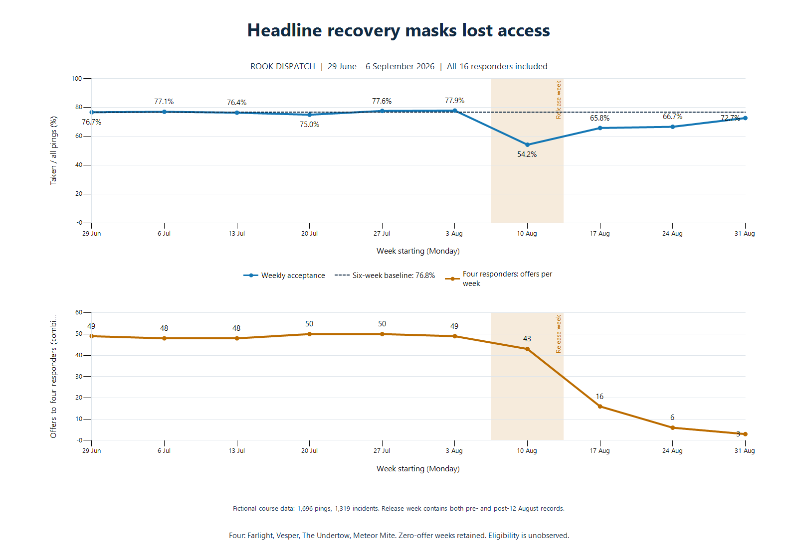

# Verified Dispatch metrics and responder access

Module 3 · Analysis date 12 November 2026 · Fictional Rook Industries  
Source window: 29 June–6 September 2026. These are historical scenario records, not current live operating conditions.

## Business finding

The headline rate recovers while access deteriorates for a small but material cohort. Four of sixteen responders move from roughly 10–14 offers per week to zero or one in the final week. Their combined share of offers falls from 28.4% in baseline to 1.8% in the final week. Zero accepted pings for the four across the final two weeks is observed; being available, eligible or intentionally excluded is not established by this schema.

The finding changes the business question from “is average acceptance recovering?” to “are ready responders retaining access to appropriate work, and are incidents receiving reliable responses?” Readiness and appropriateness need additional telemetry.

## Definitions and comparison design

- One ping is one offer to one responder; one callout can generate several sequential offers. Acceptance = taken / all pings, with missed and turned down both in the denominator. Period rates use pooled counts.
- Callout take rate = callouts with a taken ping / all callouts. It measures a recorded assignment, not attendance, resolution or a capability coverage gap.
- Baseline: six Monday–Sunday weeks, 29 June–9 August. Transition: 10–16 August, containing the 12 August release. Post: three Monday–Sunday weeks, 17 August–6 September. Compare weekly averages where periods differ.
- The release timestamp and per-ping release version are absent. Release week is mixed. An exact calendar-date sensitivity analysis below keeps 12 August separate.
- SQL operates on source-local timestamp-without-time-zone fields. The connector serializes dates with Z; that suffix does not establish UTC. No Chicago time conversion was applied to the scenario's local dates.
- The 16-responder roster is crossed with all ten weeks to retain zero-offer weeks. Acceptance for a zero-offer week is undefined, never imputed as 0%.
- The severe-exposure cohort is a descriptive screen: baseline average at least ten offers/week and final-week offers at most one. It identifies Farlight, Vesper, The Undertow and Meteor Mite after examining the records; it is not a causal treatment group.

## Period scorecard

| Period | Weeks | Incidents | Pings | Taken | Turned down | Missed | Acceptance | Missed share | Callout take rate |
| --- | ---: | ---: | ---: | ---: | ---: | ---: | ---: | ---: | ---: |
| Baseline · 29 Jun–9 Aug | 6 | 837 | 1034 | 794 | 216 | 24 | 76.8% | 2.3% | 94.9% |
| Release week · 10–16 Aug | 1 | 110 | 177 | 96 | 43 | 38 | 54.2% | 21.5% | 87.3% |
| Post · 17 Aug–6 Sep | 3 | 372 | 485 | 332 | 80 | 73 | 68.5% | 15.1% | 89.2% |

Incident demand falls 11.1% on a per-week basis; offers fall 6.2%. Recorded assignments fall from 132.3/week to 110.7/week, a 16.4% reduction. There are 43 baseline incidents and 40 post incidents with no taken ping in the extract, over six and three weeks respectively. These must not be labeled capability gaps or permanently unhandled incidents without further evidence.

Missed share rises from 2.3% to 15.1%, while explicit turned-down share falls from 20.9% to 16.5%. This supports investigating missed offers and access, rather than assuming an across-the-board rise in deliberate rejection. It does not distinguish device delivery failure, inability to answer, shorter timeout or changed selection.

## Every week

| Week starting | Incidents | Pings | Taken | Turned down | Missed | Acceptance | Missed share | Incidents without a taken ping |
| --- | ---: | ---: | ---: | ---: | ---: | ---: | ---: | ---: |
| 2026-06-29 | 141 | 172 | 132 | 37 | 3 | 76.7% | 1.7% | 9 |
| 2026-07-06 | 139 | 170 | 131 | 35 | 4 | 77.1% | 2.4% | 8 |
| 2026-07-13 | 138 | 174 | 133 | 35 | 6 | 76.4% | 3.4% | 5 |
| 2026-07-20 | 144 | 176 | 132 | 39 | 5 | 75.0% | 2.8% | 12 |
| 2026-07-27 | 137 | 170 | 132 | 34 | 4 | 77.6% | 2.4% | 5 |
| 2026-08-03 | 138 | 172 | 134 | 36 | 2 | 77.9% | 1.2% | 4 |
| 2026-08-10 | 110 | 177 | 96 | 43 | 38 | 54.2% | 21.5% | 14 |
| 2026-08-17 | 121 | 158 | 104 | 26 | 28 | 65.8% | 17.7% | 17 |
| 2026-08-24 | 124 | 162 | 108 | 30 | 24 | 66.7% | 14.8% | 16 |
| 2026-08-31 | 127 | 165 | 120 | 24 | 21 | 72.7% | 12.7% | 7 |

The final-week headline is 72.7%, still 4.1 percentage points below pooled baseline. The other twelve responders take 120/162 offers (74.1%); the four take 0/3. The improving headline contains both improving observed outcomes and sharply changing offer weights. The available records do not identify the counterfactual rate had the four continued to receive baseline exposure.

## Every responder

| Responder | Baseline offers/week | Post offers/week | Change in weekly offers | Final-week offers | Final-week taken | Baseline acceptance | Post acceptance |
| --- | ---: | ---: | ---: | ---: | ---: | ---: | ---: |
| Farlight | 12.0 | 1.3 | -88.9% | 0 | 0 | 73.6% | 0.0% |
| Vesper | 13.8 | 2.7 | -80.7% | 1 | 0 | 81.9% | 12.5% |
| The Undertow | 12.0 | 2.0 | -83.3% | 1 | 0 | 77.8% | 16.7% |
| Meteor Mite | 11.2 | 2.3 | -79.1% | 1 | 0 | 68.7% | 14.3% |
| Corporal Ashgrove | 10.0 | 7.3 | -26.7% | 7 | 5 | 78.3% | 68.2% |
| Halfmoon | 11.0 | 8.3 | -24.2% | 8 | 7 | 72.7% | 68.0% |
| Sgt. Bulwark | 9.0 | 10.7 | 18.5% | 11 | 8 | 75.9% | 71.9% |
| The Longcast | 7.2 | 8.7 | 20.9% | 9 | 7 | 74.4% | 69.2% |
| The Drift | 6.2 | 7.7 | 24.3% | 8 | 5 | 83.8% | 69.6% |
| Cindermark | 9.0 | 11.7 | 29.6% | 12 | 9 | 79.6% | 71.4% |
| Nightwell | 15.0 | 19.7 | 31.1% | 21 | 15 | 75.6% | 71.2% |
| Stormwrack | 13.0 | 17.7 | 35.9% | 19 | 15 | 79.5% | 75.5% |
| Captain Vantage | 12.0 | 16.7 | 38.9% | 18 | 13 | 73.6% | 74.0% |
| Ironvale | 8.0 | 11.0 | 37.5% | 12 | 9 | 77.1% | 69.7% |
| Sgt. Falkirk | 10.0 | 14.7 | 46.7% | 16 | 11 | 80.0% | 70.5% |
| The Gale | 13.0 | 19.3 | 48.7% | 21 | 16 | 78.2% | 72.4% |

Post acceptance spans three weeks, not the final week alone. Small denominators for the four require restraint when interpreting percentages.

Together the four receive 294 baseline pings over six weeks (49/week), then 25 over three weeks (8.3/week), an 83.0% fall. The other twelve receive 740 baseline pings (123.3/week), then 460 (153.3/week), a 24.3% increase.

Corporal Ashgrove's weekly offers fall 26.7%; Halfmoon's fall 24.2%. Their complaints are supported, but they are not the four with near-zero final-week exposure. The roster-wide audit finds Vesper and Meteor Mite, who do not appear in the ticket queue.

## Offer matrix including zeros

Each cell is a count of sent pings, not accepted assignments.

| Responder | 2026-06-29 | 2026-07-06 | 2026-07-13 | 2026-07-20 | 2026-07-27 | 2026-08-03 | 2026-08-10 | 2026-08-17 | 2026-08-24 | 2026-08-31 |
| --- | ---: | ---: | ---: | ---: | ---: | ---: | ---: | ---: | ---: | ---: |
| Farlight | 12 | 12 | 11 | 12 | 13 | 12 | 10 | 3 | 1 | 0 |
| Vesper | 14 | 13 | 15 | 14 | 13 | 14 | 12 | 5 | 2 | 1 |
| The Undertow | 12 | 11 | 12 | 13 | 12 | 12 | 11 | 4 | 1 | 1 |
| Meteor Mite | 11 | 12 | 10 | 11 | 12 | 11 | 10 | 4 | 2 | 1 |
| Corporal Ashgrove | 10 | 11 | 10 | 9 | 10 | 10 | 10 | 8 | 7 | 7 |
| Halfmoon | 11 | 10 | 11 | 12 | 11 | 11 | 11 | 9 | 8 | 8 |
| Sgt. Bulwark | 9 | 9 | 10 | 9 | 8 | 9 | 10 | 10 | 11 | 11 |
| The Longcast | 7 | 7 | 8 | 7 | 7 | 7 | 8 | 8 | 9 | 9 |
| The Drift | 6 | 6 | 7 | 6 | 6 | 6 | 7 | 7 | 8 | 8 |
| Cindermark | 9 | 9 | 8 | 10 | 9 | 9 | 10 | 11 | 12 | 12 |
| Nightwell | 15 | 14 | 15 | 16 | 15 | 15 | 16 | 18 | 20 | 21 |
| Stormwrack | 13 | 13 | 12 | 14 | 13 | 13 | 14 | 16 | 18 | 19 |
| Captain Vantage | 12 | 13 | 12 | 11 | 12 | 12 | 13 | 15 | 17 | 18 |
| Ironvale | 8 | 8 | 9 | 8 | 7 | 8 | 9 | 10 | 11 | 12 |
| Sgt. Falkirk | 10 | 10 | 11 | 10 | 9 | 10 | 11 | 13 | 15 | 16 |
| The Gale | 13 | 12 | 13 | 14 | 13 | 13 | 15 | 17 | 20 | 21 |

## Demand context and competing explanations

The home-area demand of the severe cohort changes as follows. “Home area” is the responder-table field; there are no eligible-candidate lists or capability-tag snapshots, so area demand cannot be used as an exposure entitlement.

| Area | Baseline incidents/week | Post incidents/week | Change |
| --- | ---: | ---: | ---: |
| Uptown | 9.5 | 9.0 | -5.3% |
| Old Town | 11.5 | 11.3 | -1.4% |
| Harborside | 10.2 | 9.3 | -8.2% |
| Eastgate | 18.7 | 16.0 | -14.3% |

The Gale and Meteor Mite share Eastgate in the roster. Mite's offers average 11.2/week before, then 4, 2 and 1 in the three post weeks. Gale's average 13/week before, then 17, 20 and 21. This independently supports Kip's observation of divergence, but it does not establish identical capability, availability, proximity or eligibility.

- General demand softening is real in this extract and may explain part of the aggregate decline.
- A uniform demand-dip explanation is inadequate for these concentrated differences. Historical availability, incident mix and eligibility remain plausible confounders.
- There is no prior-year data to validate Priya's seasonal explanation. Persistent low exposure into September is not recovery for the four.
- The timeout reduction and routing changes remain candidate mechanisms. Code, scoring history and delivery/answer events must establish whether misses influence future offers and through which path.

## Triangulation with customer evidence

| Signal from Module 2 | What the database supports | What remains open |
| --- | --- | --- |
| Farlight and The Undertow repeatedly report little work | Their post offers collapse to four and six across three weeks; final week zero and one | Actual availability/eligibility and why offers fell |
| Ashgrove and Halfmoon report fewer offers | Post weekly counts fall about 27% and 24% | Whether availability, demand or routing explains the milder decline |
| Aunt Dot describes Vesper's quiet stretches | Vesper moves from 13.8 offers/week to a final-week count of one | Missing customer-side records and technical cause |
| Kip contrasts Meteor Mite and The Gale | Opposing offer trajectories in the same home area | Capability/eligibility differences and actual fatigue; offers do not measure exhaustion |
| Handlers describe offers gone before an answer | Missed share jumps after the release period | No answer timestamp or notification receipt event to prove each report's timing |

References: [Aunt Dot](https://app.notion.com/p/3eac8516f50181a0bf04dd3b61063feb), [Kip](https://app.notion.com/p/3eac8516f501815f9b0bc8b80e97d20a), and [Module 2 ticket comparison](../02-super-hearing/support-tickets-before-after-12-august.md).

## Exact-date sensitivity analysis

This second cut does not use the mixed release week as a clean treatment period. Before is 29 June–11 August (44 days), release day is 12 August, after is 13 August–6 September (25 days).

| Calendar period | Pings | Taken | Turned down | Missed | Acceptance | Missed share |
| --- | ---: | ---: | ---: | ---: | ---: | ---: |
| before_12_aug | 1085 | 831 | 229 | 25 | 76.6% | 2.3% |
| on_12_aug | 25 | 11 | 7 | 7 | 44.0% | 28.0% |
| after_12_aug | 586 | 380 | 103 | 103 | 64.8% | 17.6% |

This cut also shows worse observed acceptance and more missed pings after release day. It does not remove all confounding or recover the unknown rollout timestamp. Its after-window ends a day earlier than the support-ticket dataset; 7 September support reports are not treated as fully observable ping windows.

## Credibility checks and evidence gaps

All 10 checks in [validation.json](evidence/validation.json) passed: complete page retrieval; unique ping tuples/callout IDs/roster names; null and outcome checks; valid joins; no ping preceding its incident; at most one taken ping per incident; independent raw-record aggregation matching SQL; and zero-inclusive responder-week reconciliation. All 70 dates are represented in both tables, and no ping crosses its incident's week. A follow-up query also finds no equal-time offers within a callout; the raw sequence shows no offers after a taken ping.

These tests establish consistency of the retrieved tables, not completeness of upstream logging. There is no availability history, matching candidate set, capability snapshot, score history, device delivery evidence, answered-at field, rollout log or prior-year comparison. Median time-to-accept, eligibility-adjusted allocation, actual fatigue, revenue loss and legal identities cannot be derived.

A targeted wiki title search for “weekly” returned no results. These are independently computed SQL metrics, not a purported copy of Ravi's official report.

## Operational scorecard to propose

| Measure | Business use | Current status |
| --- | --- | --- |
| Offers and taken assignments per responder/week | Spot collapsing access before a headline conceals it | Computable, zero-inclusive |
| Days since last recorded offer; change from personal baseline | Trigger handler/engineering review | Computable; alert thresholds require operational calibration |
| Missed vs deliberately declined share | Separate nonresponse from explicit refusal | Computable; causes of misses are unobserved |
| Callouts with no taken ping; attempts per callout | Monitor assignment reliability and coordination burden | Computable in extract; incident resolution unobserved |
| Offers per eligible available opportunity | Test allocation against readiness and matching | Requires eligibility and availability history |
| Median time-to-accept and delivery-to-answer time | Validate the response-window experience | Requires delivery/answer timestamps |

Monitoring should pair opportunity and outcomes; an improving acceptance ratio cannot close an access investigation when the most affected customers have almost no observations.

## Decision and Module 4 handoff

Recommend Helen keep the service investigation open; ask Marcus and Wen to trace the timeout-to-missed-to-history-to-ranking path and the eligibility updates before selecting a fix. Assign Ravi a zero-inclusive operational view, and Nadia/Sofia the handler corroboration and communication plan. These are proposed ownership assignments, not actions sent to colleagues.

Traceable cases:
- Farlight: callout #41245, missed on 28 August at 19:28:20; no later offer in the extract.
- Vesper: #41311, missed on 1 September at 11:42:44.
- Meteor Mite: #41393, missed on 5 September at 15:06:20.
- The Undertow: #41394, missed on 5 September at 15:17:47.

For each, obtain the candidate list, score components, prior-history state, wait deadline, notification receipt and subsequent eligibility changes. Compare against unaffected responders and the Gale/Mite Eastgate contrast. Validate expected business behavior with Product before changing code. Supply's dependence on the shared availability record requires an explicit impact check if that record changes.

Module 3 stops at verified metrics, reconciled customer signals and a falsifiable technical handoff. A causal implementation finding belongs to Module 4.

## Reproduction

[queries.sql](queries.sql) records executed read-only SQL, including three ping pages and two incident pages below the connector's 1,000-row limit. [Evidence manifest](evidence/manifest.json) defines cutoffs and limitations. Raw tables, 160 zero-inclusive responder-week rows, weekly/period summaries and validation results are saved in evidence/. No pings or incidents were sampled.

