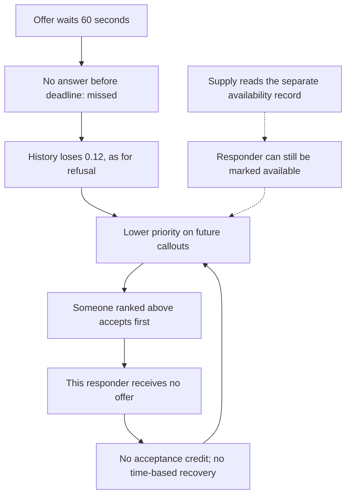

# Routing mechanism validated against the metrics

Module 4 · 12 November 2026 · Fictional Rook Dispatch

## Conclusion and confidence

The supplied code implements an opportunity feedback loop: shorter wait window → additional possible misses → the same penalty as refusal → lower future rank → fewer actual offers when others accept first → fewer chances to earn recovery credit. History has no implemented time decay. This is sufficient to reproduce a persistent loss of offers in a controlled setting while responders remain on the supplied candidate list.

It is not a complete historical causal replay. Device delivery, availability and travel-time implementations are omitted as ellipses. The database lacks candidate snapshots, capabilities, score state, answer timestamps and release versions. Tests control these inputs explicitly; source comments and module headers are not used as substitutes for observed production evidence.

## Source trace

| Step | Exact source location | Business implication |
| --- | --- | --- |
| 60-second window; prior 90 documented | config.py:9 | Some previously timely responses can become late |
| Proximity 0.60, history 0.25, capability 0.15 | config.py:13–15 | Proximity increased, but history still influences access |
| Stop at first taken offer | offer.py:25–29 | A candidate can remain listed and never receive a ping |
| Every non-taken outcome invokes record_declined | offer.py:30 | Explicit refusal and timeout have the same history effect |
| Deadline is strict and expiry returns missed | offer.py:41–48 | The controlled answer at exactly 60 seconds is already outside the wait loop |
| Accepted adds 0.08; declined/missed subtracts 0.12 | history.py:25–39 | Two refusals/misses cost the same score as three acceptances earn, before clamping |
| Recovery-through-time considered but not implemented | history.py:30–34; recent_acceptance at 20–22 | Quiet time alone cannot improve a retained score |
| Floor and ceiling | history.py:42–43 | Repeated penalties can pin the score at zero |
| Candidate source then descending sort | routing.py:24–27 | Everyone supplied by available_for remains listed; order governs opportunity |
| History is a ranking input | routing.py:38–42 | A score penalty changes future priority without changing readiness |
| Availability is set by responder/handler; Supply reads current_record | availability.py:4–16,29–35 | Availability and acceptance history are separate concepts |

Paths are relative to [dispatch-routing](../00-rook/code/dispatch-routing/README.md). Concrete callable definitions and line numbers were inspected. No source/configuration was edited.

## Mechanism at a glance



The current callout's rank list is computed once before the dispatch loop. Penalties and credits feed subsequent ranking calls, not a re-sort of the current remaining list.

## Controlled validation

The harness imports the actual config, offer, history, routing and availability modules. It substitutes only omitted external adapters and the clock. No real pushes, waits or external messages occur.

| Business question | Executed case | Result |
| --- | --- | --- |
| Can the window change turn willingness into a miss? | Same response at 75 seconds; window 90 vs 60 | Taken vs missed |
| Where is the exact deadline? | Responses at 59 and 60 seconds | Taken at 59; missed at 60 |
| Is missed distinct from refused for scoring? | Dispatch one of each from neutral 0.5 | Both end at 0.38 |
| Can history alter access without readiness changing? | Near candidate: 10 min/history 0.5; farther: 20 min/history 0.9 | One near miss plus farther acceptance reverses priority |
| Does listed imply offered? | Lower history candidate remains listed during 50 callouts accepted by leader | Zero offers to lower candidate; history unchanged at 0.26 |
| Does time restore the retained score? | Same score observed on callouts a year apart | No calendar recovery |
| Does restoring 90 seconds repair existing state? | Existing low score; leader accepts under a 90-second window | Low-score candidate still unoffered; history unchanged |
| Does dispatch mark the responder unavailable? | Miss with unchanged readiness fixture and current_record spy | No readiness mutation; no current_record call |
| Are score bounds and recovery symmetric? | Five penalties from neutral; then credits | Floor 0; seven acceptances needed to reach at least neutral |
| Are historical outcomes fully accounted for in replay? | All Module 3 records and all 16 roster entries | 1,696 events; 1,222 taken, 339 declined, 135 missed |
| Is capability a hard gate here? | Available-for fixture supplies an incapable but very near candidate | Ranking/dispatch can select it; omitted upstream gate must be checked |

The rank-reversal example is quantitative: near candidate starts at 0.7417 versus farther 0.7083. After the near miss and farther acceptance, scores are 0.7117 versus 0.7283. Both the penalty and the competitor's credit matter. This is an illustration under stated inputs, not a historical reconstruction for named responders.

All **16 tests pass**, including exhausted candidate lists, positive acceptance credit, zero-history retention, and source-hash checks. [Validation results](evidence/mechanism-validation.json) include logs and controlled inputs.

## Fixed observed-sequence replay

All 1,696 observed offers are processed in sent-time order. Taken invokes record_accepted; missed and turned down invoke record_declined. The three starting-state assumptions are every responder at 0, 0.5 or 1. The replay uses the supplied in-memory history implementation and retains state across the extract.

The table below uses the neutral start. Each row is an end-of-week **modeled score**, not a score read from production.

| Week starting | Farlight | Vesper | The Undertow | Meteor Mite |
| --- | ---: | ---: | ---: | ---: |
| 2026-08-03 | 0.80 | 0.96 | 1.00 | 1.00 |
| 2026-08-10 | 0.40 | 0.68 | 0.32 | 0.56 |
| 2026-08-31 | 0.00 | 0.00 | 0.00 | 0.00 |

All three seeds converge to these four's shown end-baseline, release-week and final scores. Neutral-start end scores for all other twelve are above zero. Initial-state sensitivity is reduced for these cases, but historical persistence/reset behavior remains unknown.

A second sensitivity run makes missed outcomes neutral while holding every observed offer and outcome fixed. Final scores become 0.80, 0.76, 0.84 and 0.84 respectively. This isolates the scoring contribution of missed outcomes within a fixed sequence. It does not predict the offers they would receive, their answers under a different deadline, or the effect of deploying that policy.

Files: [full replay](evidence/fixed-sequence-replay.json), [summary](evidence/replay-summary.json). The full replay saves per-event modeled scores and all ten weekly snapshots for each starting-state run.

## Crosswalk to Module 3

| Verified metric observation | What this code can explain | What still needs deployed evidence |
| --- | --- | --- |
| Missed share 2.3% baseline to 15.1% in three post weeks | A smaller window creates misses for responses between the two deadlines | Actual answer/delivery times, other causes of nonresponse and rollout timestamps |
| Four responders fall from 49 offers/week to three combined in the final week | Repeated misses lower priority; earlier acceptance can terminate each sequence | Actual candidate membership, score components, travel times and matched capability |
| Four have no taken ping in final two weeks | No offers means no credit; rare remaining offers may also miss | Whether this specific loop caused each historical loss |
| Overall acceptance returns to 72.7% | Reduced exposure removes low-acceptance cases from much of the denominator | Counterfactual aggregate or customer outcomes under a different policy |
| The Gale gains offers while Meteor Mite loses them in Eastgate | Priority changes can concentrate offers within a supplied pool | Same-region does not prove identical eligibility or readiness |

Demand softening and unobserved availability remain possible contributors. The code supplies a concrete mechanism rather than ruling out every competing explanation.

## What changed in 4.2 and what predates it

The changelog and config comments document 90 → 60 seconds and weights 0.45/0.40/0.15 → 0.60/0.25/0.15. The penalty and missing recovery policy are not documented as new in 4.2; the recovery TODO is dated 2019.

The reweighting **reduces** the score contribution lost per miss from 0.40 × 0.12 = 0.048 to 0.25 × 0.12 = 0.030, before the floor. It therefore does not make each individual history penalty mathematically larger. It can independently change rank order, as the controlled weight test shows. The shorter deadline can send more responses into an existing penalty path.

Restoring the previous window could reduce new deadline misses, but it does not clear existing history. Rolling back the weights also restores the larger history contribution. Neither action can be assumed to deliver customer recovery without examining state and opportunity.

## Readiness and Supply boundary

The source README says “everyone available is on the list.” This describes candidate inclusion, not guaranteed offers. offer.dispatch returns at the first acceptance.

Availability is responder/handler-set in the documented adapter; the supplied rank/offer path reads candidates and travel time and changes history only. There is no demonstrated automatic “mark unavailable” branch here. A falling score must not be reported as proof that Dispatch changed availability.

Supply reads current_record; both the record shape and the business meaning of readiness require compatibility. The adapter and Supply scheduler are omitted, so a real consumer contract test cannot be completed from these files. The test establishes the narrow current-component boundary, not end-to-end scheduling safety.

Any recovery design should keep declared availability separate from response history. If the shared record changes, involve the Supply owner, test actual payloads and scheduling outcomes, and document migration and rollback.

## Secondary eligibility question

Capability is a soft 15% score in this module. A deliberately supplied incapable candidate can outrank a capable one and receive an offer. The available_for implementation is absent, so it may enforce a hard eligibility gate elsewhere. This is an unresolved precondition for any recovery path, not evidence that real incidents were assigned to incapable responders.

Require capability/region/availability checks before any return-to-routing opportunity. Do not turn recovery into equal allocation or guaranteed work that displaces the best qualified response.

## Product and operating decision

Treat this as a policy and recovery problem with a possible window-containment action:
1. Preserve missed versus explicit refusal as distinct events and show the right reason to handlers.
2. Validate the response window against delivery-to-answer evidence and incident escalation needs.
3. Define a bounded, auditable return path for affected, eligible, ready responders; accepting work cannot be the only way back if offers have disappeared.
4. Pair acceptance with offer exposure, time since last offer, matched available opportunity and callout assignment reliability.
5. Preserve Supply's readiness contract and verify the omitted capability gate before rollout.

Helen owns the policy decision; Marcus/Wen the implementation and rollout case; Ravi the scorecard and telemetry; Nadia/Sofia the customer explanation and recovery experience. These are proposed assignments; no messages have been sent.

## Remaining production validation

Retrieve for Module 3's concrete cases (#41245, #41311, #41393, #41394): deployed code version, candidate list, score breakdown before dispatch, delivery receipt, deadline, answer event, history update, and next eligible-callout rankings. Obtain actual historical score persistence and readiness windows. Confirm outcome classification and monitor assignment delay/callout take rate when testing a longer window.

Those records would upgrade a reproduced teaching-code mechanism into incident-level causal attribution. They are not needed to establish what the supplied functions do, and they cannot be fabricated from the current database.

## Reproduction

From the course root:
```powershell
python -B 04-x-ray-vision/validate_mechanism.py
```

Tested with Python 3.11.5 and standard library only. The script writes evidence under this module, imports original modules with bytecode generation disabled, and checks five source hashes. No configuration, production service, database row or source Python file was changed.

